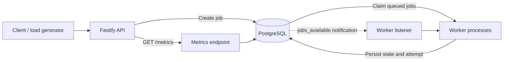
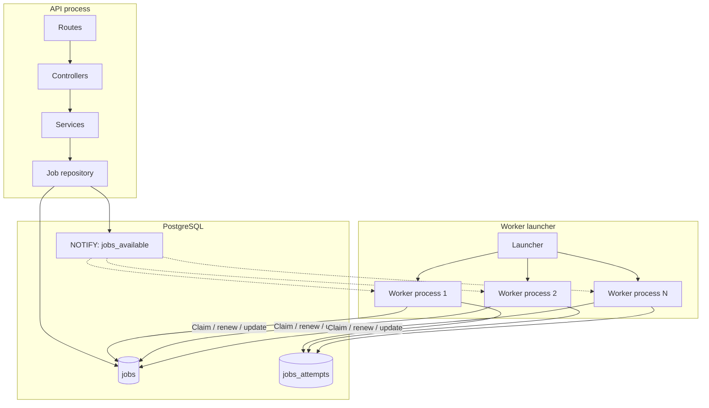
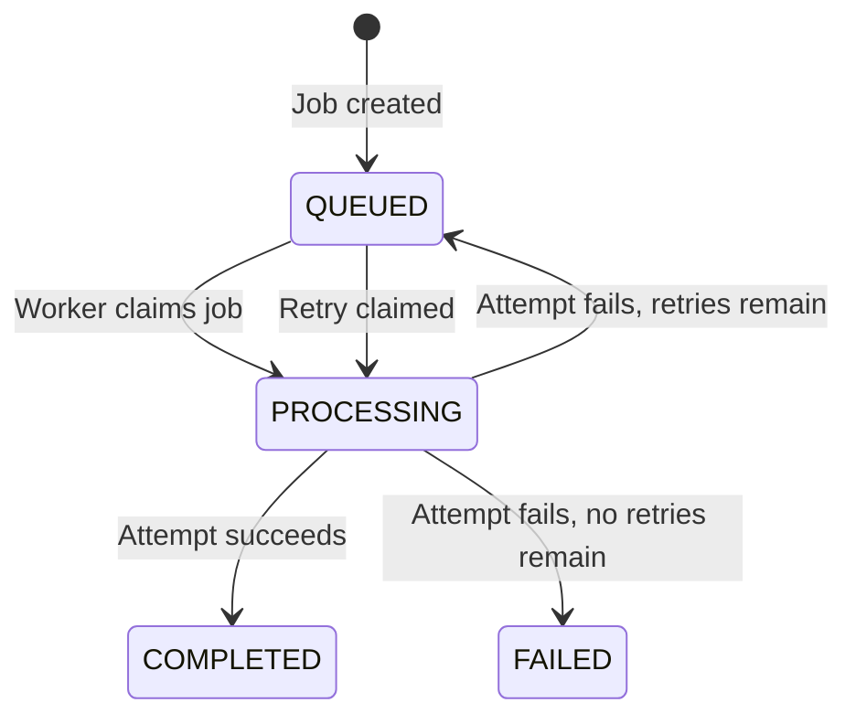
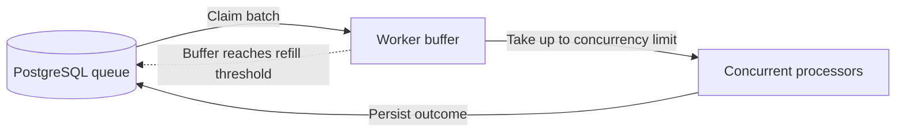
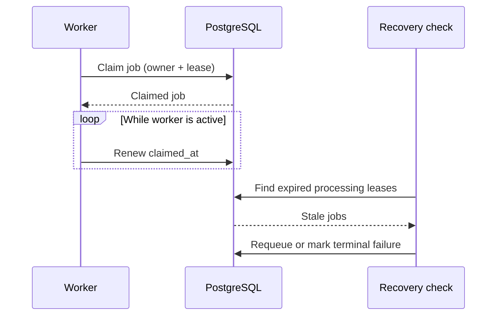

# FlowForge

### A PostgreSQL-backed job queue built to explore concurrency, recovery, and throughput

FlowForge is a backend systems project that accepts asynchronous jobs, stores them in PostgreSQL, and processes them through configurable worker processes.

The project explores what happens when a queue must handle concurrent workers, retries, worker interruptions, database coordination, and performance measurement.

> **Project focus:** Persistent job queue · Concurrent workers · Failure recovery · Observability
> **Stack:** TypeScript · Node.js · Fastify · PostgreSQL · `pg`

FlowForge is an educational implementation—not a drop-in replacement for a mature production queue service. Its value is in the engineering concepts demonstrated: durable queue state, worker coordination, retries, recovery, and observability.

---

## Contents

* [What FlowForge does](#what-flowforge-does)
* [Architecture](#architecture)
* [Job lifecycle](#job-lifecycle)
* [Worker coordination](#worker-coordination)
* [Reliability and recovery](#reliability-and-recovery)
* [Metrics and observability](#metrics-and-observability)
* [Worker processing benchmark](#worker-processing-benchmark)
* [Tech stack and project structure](#tech-stack-and-project-structure)
* [Run locally](#run-locally)
* [HTTP API](#http-api)
* [Database model](#database-model)
* [Design decisions](#design-decisions)
* [Current scope and limitations](#current-scope-and-limitations)

---

## What FlowForge does

FlowForge provides a persistent queue and a separate worker layer.

* Accepts jobs through a Fastify API.
* Stores job state in PostgreSQL.
* Lets multiple worker processes claim queued jobs concurrently.
* Processes a configurable number of jobs at a time inside each worker.
* Buffers claimed jobs locally to reduce repeated queue-fetch queries.
* Simulates workload duration and probabilistic failures to exercise retry behavior.
* Uses PostgreSQL notifications to wake workers, with polling as a fallback.
* Tracks worker ownership through leases and recovers stale `PROCESSING` jobs.
* Releases jobs remaining in a worker's local buffer during graceful shutdown.
* Records normal completed processing attempts and exposes queue and historical metrics.
* Supports configurable worker count, concurrency, buffer size, and database pool size.

### At a glance



PostgreSQL is the durable source of truth. Notifications are wake-up signals; workers still query PostgreSQL to claim jobs.

---

## Architecture

### Main components

| Component           | Responsibility                                                                                                           |
| ------------------- | ------------------------------------------------------------------------------------------------------------------------ |
| **Fastify API**     | Validates HTTP requests and exposes job, health, and metrics endpoints.                                                  |
| **Job service**     | Applies workload configuration and coordinates job creation/retrieval.                                                   |
| **Job repository**  | Reads and writes job records; claims queued jobs and manages ownership, leases, and recovery.                            |
| **PostgreSQL**      | Stores job state and attempt history; coordinates competing workers.                                                     |
| **Worker launcher** | Starts the configured number of worker child processes.                                                                  |
| **Worker process**  | Maintains a notification listener, claims batches, schedules concurrent processing, renews leases, and handles shutdown. |
| **Job processor**   | Simulates execution and success/failure, then persists the resulting job state and attempt record.                       |
| **Metrics module**  | Queries current queue state and historical timestamps, then calculates metrics.                                          |

### Process and data flow



Workers are separate Node.js processes. Each worker has its own database pool and notification connection. Pool size therefore matters across the deployment: the potential connection count grows with the number of worker processes.

---

## Job lifecycle

A job moves through four stored states:

* `QUEUED` — available for a worker to claim.
* `PROCESSING` — claimed by a worker and in progress or waiting in its local buffer.
* `COMPLETED` — processing succeeded.
* `FAILED` — retries were exhausted or the job was otherwise marked terminal.

### Normal processing and retries



FlowForge uses simulated workloads. Workload configuration determines execution duration, retry allowance, and failure probability. This makes it possible to exercise queue mechanics without depending on an external email service, API, or other side effect.

### Job versus attempt

A **job** is the unit stored in the queue. An **attempt** is one execution of that job.

For example, a job that fails twice and succeeds on its third execution has one job record and three executions. Its normal processor outcomes are two retryable failures followed by one success.

The `jobs_attempts` table stores attempt number, start and finish timestamps, and outcome. The normal processor path persists the job transition and attempt history in one database transaction.

---

## Worker coordination

### 1. Atomic job claiming

Workers claim a batch from PostgreSQL using `FOR UPDATE SKIP LOCKED`. Selected rows are changed from `QUEUED` to `PROCESSING` and assigned to a worker.

Simplified illustration:

```sql
WITH candidates AS (
    SELECT id
    FROM jobs
    WHERE status = 'QUEUED'
    ORDER BY created_at
    FOR UPDATE SKIP LOCKED
    LIMIT $1
)
UPDATE jobs
SET status = 'PROCESSING',
    worker_id = $2,
    claimed_at = NOW(),
    updated_at = NOW()
WHERE id IN (SELECT id FROM candidates)
RETURNING *;
```

The repository uses an atomic update with a locked subquery. This lets workers compete for queued jobs without waiting on rows already locked by another claimant.

### 2. Local buffering

Each worker claims jobs in batches and keeps them in an in-memory buffer.



Batching reduces the frequency of claim queries. It also means a job can be in `PROCESSING` because it has been claimed and buffered, even if its execution has not started yet.

A larger buffer can reduce database overhead, but it also reserves more jobs in a worker before they begin execution. Buffer size and refill threshold are configurable.

### 3. Concurrency

Two controls shape processing capacity:

* **Worker count:** number of worker processes.
* **Worker concurrency:** maximum number of jobs scheduled together by each worker.

Configured concurrency is:

`worker count × concurrency per worker`

This is a configured ceiling, not a guarantee that all slots are busy. Actual throughput depends on job duration, CPU and memory, database capacity, buffer behavior, and the workload.

### 4. Notifications plus polling

When a job is created, the API sends a PostgreSQL `NOTIFY` on `jobs_available`. Workers listen for the notification and wake up to check the queue.

Notifications do not contain the job itself and are not treated as durable queue entries. Workers claim jobs from the `jobs` table. Polling and recovery checks provide a fallback if a notification is missed or the listener reconnects.

---

## Reliability and recovery

FlowForge includes mechanisms intended to make worker interruptions recoverable.

### Ownership and leases

When a worker claims a job, the row receives a `worker_id` and `claimed_at` timestamp. Updates to a processing job check that it is still `PROCESSING` and owned by that worker.

Workers periodically renew leases. If a processing job's lease becomes stale, recovery can requeue it when retries remain or mark it failed when retry allowance is exhausted.



### Graceful shutdown

On `SIGINT` or `SIGTERM`, a worker begins shutting down, stops taking additional work, releases jobs still waiting in its local buffer, closes its notification listener, and closes its database pool after the active worker execution settles.

### Listener reconnection

The PostgreSQL listener reconnects after connection errors or disconnection using exponential backoff. The worker loop also polls, so wake-up does not depend exclusively on a continuously healthy notification connection.

### Delivery guarantee

FlowForge is designed around recoverable database state, but it does **not** guarantee exactly-once execution. A worker can perform work and then crash before persisting its result; stale-job recovery may cause the job to run again.

For real jobs with external side effects, idempotency or other duplicate-effect protection would be needed. The current simulated workload avoids that external-side-effect problem.

---

## Metrics and observability

The metrics endpoint is:

```http
GET /metrics
GET /metrics?window=5m
```

The `window` parameter accepts a positive number of minutes followed by `m`, such as `1m`, `5m`, or `15m`. If omitted, the controller defaults to `1m`.

The endpoint combines **current state snapshots** with **historical measurements over the selected window**.

### Metric definitions

| Metric                                                                | Meaning in the implementation                                                                                                                         |
| --------------------------------------------------------------------- | ----------------------------------------------------------------------------------------------------------------------------------------------------- |
| `workerCount`                                                         | Configured worker-process count from environment settings.                                                                                            |
| `concurrency`                                                         | Configured concurrency per worker, not a live count of occupied slots.                                                                                |
| `queueSize`                                                           | Current number of jobs in `QUEUED` state.                                                                                                             |
| `currentlyProcessing`                                                 | Current number of jobs in `PROCESSING` state, including jobs claimed into buffers.                                                                    |
| `completedJobs`                                                       | Successful attempt outcomes recorded in the selected time window.                                                                                     |
| `retryableFailures`                                                   | Retryable attempt outcomes recorded in the window; a job can contribute more than one.                                                                |
| `terminalFailures`                                                    | Terminal-failure attempt outcomes recorded in the window.                                                                                             |
| `avgProcessingTimeMs`                                                 | Average `finished_at - started_at` duration for attempts finished in the window.                                                                      |
| `avgCompletionTimeMs`                                                 | Average `completed_at - created_at` duration for successful jobs completed in the window.                                                             |
| `avgQueueWaitMs`                                                      | Currently calculated from job creation to attempt start for attempts finished in the window. For retries, this includes time since original creation. |
| `throughputJobsPerMinute` / `throughputJobsPerSecond`                 | Distinct jobs with successful or terminal-failure outcomes divided by the entire selected window.                                                     |
| `observedThroughputJobsPerMinute` / `observedThroughputJobsPerSecond` | Finalized distinct jobs divided by the elapsed time between the first and last qualifying finish timestamps in the window.                            |

### Why two throughput values?

The full-window value answers:

**“How many jobs reached a final outcome per second or minute across this whole period?”**

Idle periods are included.

The observed first-to-last value answers:

**“How quickly did final outcomes occur across the span between the first and last finish in this window?”**

It can be much higher if completions cluster in a short burst, and can be unstable when the elapsed span is tiny.

The throughput calculations count distinct jobs with `SUCCEEDED` or `TERMINAL_FAILURE` outcomes. This is not the same as API job-submission rate, and it is not the same as counting every attempt.

### Metrics interpretation notes

* Queue size and processing count are current snapshots; historical counters use the selected window.
* Attempt outcome counters count attempts, not necessarily unique jobs.
* The queue-wait formula is creation-to-attempt-start, so retry queue wait is not isolated.
* The normal processor path writes job state and attempt history together. Exceptional processing errors and stale recovery may not create matching attempt-history rows, so historical failure metrics can omit those paths.
* Metrics queries run separately. During active processing, the queue snapshot and historical values can represent slightly different moments.

These definitions describe what the code calculates today and help avoid confusing the metrics during active processing.

---

## Worker processing benchmark

FlowForge was benchmarked locally using multiple worker processes and a buffered job-claiming setup.

### Benchmark configuration

| Setting | Value |
| --- | ---: |
| Worker processes | 40 |
| Concurrency per worker | 100 |
| Buffer size | 110 jobs per worker |
| Buffer threshold | 10 jobs per worker |
| Average processing time | ~758 ms |
| Test machine | Dell 14 Plus DB14255 |
| CPU | AMD Ryzen AI 5 340W |
| Graphics | AMD Radeon 840M |

### Observed results

| Metric | Result |
| --- | ---: |
| Typical interval throughput | ~700 jobs/sec |
| Peak interval throughput | ~1,200 jobs/sec |
| Jobs submitted by Autocannon | 50,000 |
| Time taken to submit 50,000 jobs | 37.04 seconds |
| Autocannon submission rate | ~1,350 jobs/sec |

**Important:** The Autocannon figure represents the rate at which jobs were submitted to the API. It is not the same as worker processing or job-completion throughput. The worker throughput figures reflect interval-based measurements observed during the test.

These are local benchmark results, not guaranteed performance figures. Throughput can vary with job workload, database configuration, system load, and hardware.

---

## Tech stack and project structure

### Stack

| Technology | Role                                                              |
| ---------- | ----------------------------------------------------------------- |
| TypeScript | Application and worker implementation                             |
| Node.js    | Runtime and worker child processes                                |
| Fastify    | HTTP API                                                          |
| PostgreSQL | Persistent jobs, attempt history, coordination, and notifications |
| `pg`       | PostgreSQL client and connection pool                             |
| `dotenv`   | Environment configuration                                         |
| `tsx`      | TypeScript development execution                                  |

### Source layout

```text
src/
├── server.ts                 # Fastify application and route registration
├── db/
│   ├── connection.ts         # PostgreSQL pool
│   └── migrations/           # Incremental schema changes
├── jobs/
│   ├── jobs.routes.ts        # Job HTTP routes
│   ├── jobs.controller.ts    # Request/response handling
│   ├── jobs.service.ts       # Workload setup and job operations
│   ├── jobs.repository.ts    # SQL, claiming, state changes, leases, recovery
│   └── jobs.types.ts         # Job/request types
├── workers/
│   ├── launcher.ts           # Starts configured worker child processes
│   ├── worker.ts              # Worker loop, listener, lease, shutdown
│   ├── worker.processor.ts   # Simulated execution and attempt persistence
│   └── jobs.listener.ts      # PostgreSQL LISTEN/NOTIFY and reconnect
├── metrics/
│   ├── metrics.routes.ts     # GET /metrics and query validation
│   ├── metrics.controller.ts # API response and configured capacity
│   ├── metrics.service.ts    # Window parsing and metric calculations
│   ├── metrics.repository.ts # SQL aggregates and snapshots
│   └── metrics.types.ts      # Metrics/request/result types
└── health/
    └── health.routes.ts      # Database health endpoint
```

---

## Run locally

### Prerequisites

* Node.js and npm
* PostgreSQL
* Git

### 1. Clone and install

```bash
git clone https://github.com/guptakrish490/FlowForge.git
cd FlowForge
npm install
```

### 2. Configure environment

Create a `.env` file in the project root. Adjust values for your PostgreSQL instance and local test:

```dotenv
PORT=3000
DATABASE_URL=postgresql://<user>:<password>@localhost:5432/flowforge

WORKER_COUNT=5
WORKER_CONCURRENCY=10

BUFFER_SIZE=60
BUFFER_THRESHOLD=30

DB_POOL_MAX=2

JOB_LEASE_TIMEOUT_MS=10000
JOB_RECOVERY_INTERVAL_MS=3000
IDLE_TIMEOUT_MS=10000
```

Worker settings such as lease timeout, recovery interval, buffer size, concurrency, and database pool size should be chosen for the test machine.

### 3. Create the database and apply migrations

Create a PostgreSQL database named `flowforge`, then apply the SQL migrations in `src/db/migrations` in numerical order.

From the repository root, on a shell that supports this loop:

```bash
for file in src/db/migrations/*.sql; do
  psql "$DATABASE_URL" -v ON_ERROR_STOP=1 -f "$file"
done
```

Use a fresh database when verifying the complete migration sequence. If using a migration runner with a tracking table, follow that runner's procedure instead of reapplying migrations blindly.

### 4. Build

```bash
npm run build
```
For a compiled run, build the project and launch the compiled server and worker launcher using the entrypoints produced under `dist/`.

### 5. Start the API

```bash
npm run dev
```

The server defaults to port `3000` unless `PORT` is set.

### 6. Start the single worker

In another terminal:

```bash
npm run dev:worker
```
Or, start the configured number of workers through the launcher:

### Start multiple workers

In another terminal:

```bash
npm run dev:launcher
```

The launcher reads `WORKER_COUNT` and starts that many worker processes.

---

## HTTP API

The API uses a response envelope with `success`, `status`, `error`, and `data` fields.

### Health check

```http
GET /health
```

Checks whether PostgreSQL is reachable. This is a database connectivity check, not a complete readiness check for every worker process.

### Create a job

```http
POST /jobs
Content-Type: application/json
```

Request:

```json
{
  "type": "demo-task",
  "workload": "LOW"
}
```

`type` is a non-empty string up to 50 characters. `workload` must be `LOW`, `MEDIUM`, or `HIGH`. Execution duration, retry allowance, and failure probability are generated from workload configuration.

A successful create returns HTTP `201` and the created job.

### List jobs

```http
GET /jobs
```

Returns stored jobs.

### Get one job

```http
GET /jobs/:id
```

Returns the requested job, or `404` if it does not exist.

### Read metrics

```http
GET /metrics?window=5m
```

Returns current queue state plus time-window metrics. See [Metrics and observability](#metrics-and-observability) for the exact field definitions.

---

## Database model

### `jobs`

The `jobs` table is the queue's source of truth. It stores job identity, workload configuration, status, retry counter, timestamps, and current worker ownership/lease fields.

| Field                 | Purpose                                               |
| --------------------- | ----------------------------------------------------- |
| `id`                  | Job identifier                                        |
| `type`                | Job type/name                                         |
| `workload`            | `LOW`, `MEDIUM`, or `HIGH`                            |
| `max_retries`         | Retry allowance                                       |
| `failure_probability` | Simulated failure chance                              |
| `burst_time_ms`       | Simulated execution duration                          |
| `status`              | `QUEUED`, `PROCESSING`, `COMPLETED`, or `FAILED`      |
| `retry_attempt`       | Retry count maintained by the lifecycle               |
| `created_at`          | Job creation time                                     |
| `started_at`          | Current/last processing-start field in the job record |
| `completed_at`        | Successful completion timestamp                       |
| `worker_id`           | Current worker owner                                  |
| `claimed_at`          | Lease timestamp used for renewal and stale recovery   |
| `updated_at`          | Last job-state update                                 |

### `jobs_attempts`

The attempts table stores historical execution information separately from current job state.

| Field            | Purpose                                                 |
| ---------------- | ------------------------------------------------------- |
| `job_id`         | Parent job                                              |
| `attempt_number` | 1-based execution attempt number                        |
| `started_at`     | Attempt start                                           |
| `finished_at`    | Attempt finish; nullable while unfinished               |
| `outcome`        | `SUCCEEDED`, `RETRYABLE_FAILURE`, or `TERMINAL_FAILURE` |

This separation lets the queue row represent the latest state while attempt rows preserve the history of recorded executions.

---

## Design decisions

### PostgreSQL as storage and coordination

Using PostgreSQL keeps the project focused on durable state, transactions, row locking, and concurrency. It avoids introducing another broker before the core queue mechanics are understood.

### `SKIP LOCKED` for competing workers

Workers can claim different queued rows concurrently. This avoids making every worker wait behind the same oldest row, while the database remains responsible for safe claiming.

### Batch claims and local buffers

Batching trades some immediacy for fewer database round trips. Buffer size and refill threshold are configurable so their impact can be measured.

### Notifications are hints, not the queue

`LISTEN/NOTIFY` helps workers react promptly, but the durable jobs table remains authoritative. Polling and recovery checks provide a fallback.

### Leases for ownership and recovery

A worker's ownership is time-bounded. Lease renewal and stale-job recovery allow the queue to make progress after a worker disappears. Leases improve recoverability, but they do not by themselves prevent duplicate external side effects after a crash.

### Metrics separate current state from recent history

Queue depth and processing count describe the present. Outcome counts, durations, and throughput describe events in a chosen historical window.

---

## Current scope and limitations

FlowForge is complete as a learning and portfolio implementation of a configurable PostgreSQL-backed worker queue. Its current scope has some clear boundaries:

* **No exactly-once guarantee:** work can be repeated after a worker crash or stale-lease recovery. External side effects would need idempotency protection.
* **No dedicated dead-letter queue or retry backoff policy:** terminal failures are represented by job state; retry behavior is currently immediate/requeue-based.
* **Attempt history is not exhaustive across every exceptional path:** the normal processor result is transactionally recorded with the job update, but processor exceptions and stale recovery may update job state without a matching attempt-history record.
* **Queue-wait metric is creation-to-attempt-start:** retry waits are not separately isolated by the current formula.
* **Metrics are monitoring snapshots:** separate queries can observe slightly different moments.

These limitations are documented so the project's guarantees are clear. They do not erase the concurrency, persistence, retry, recovery, and measurement work implemented.

---

## What this project demonstrates

FlowForge provides hands-on experience with:

* asynchronous job processing;
* concurrent worker processes;
* atomic database claiming;
* transaction boundaries;
* retries and terminal outcomes;
* leases and stale-work recovery;
* graceful process shutdown;
* PostgreSQL notification-driven wake-up with fallback polling;
* metric interpretation for current queue state and historical outcomes.

**The central learning goal:** understand how a backend behaves when concurrency, failures, database contention, and scale become part of the design—not just how to create and retrieve records.

---

## License

#### MIT LICENSE

 **Made with ❤️**